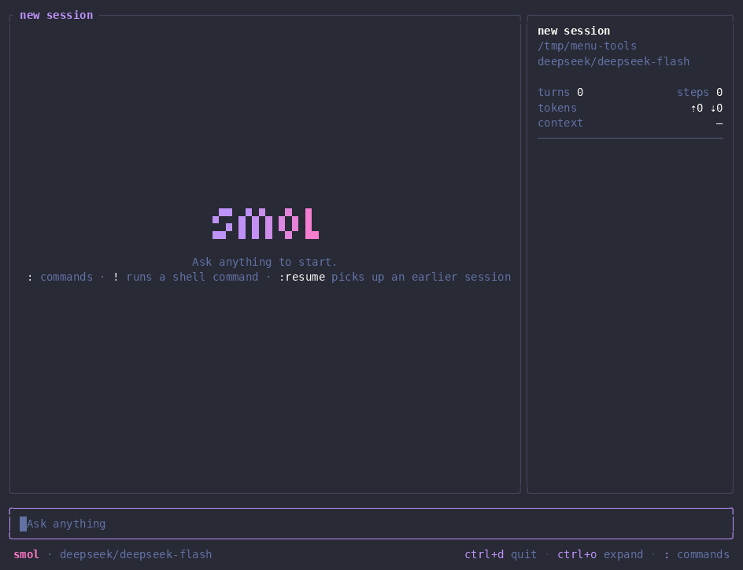

# smol

A CodeMode agent for your terminal and any ACP client. The model gets one tool,
`eval`, and does everything by writing Python in a session that keeps its
variables, functions and imports from step to step.

Inspired by [smolagents](https://github.com/huggingface/smolagents).

A real run with DeepSeek on smol's own source:


## Why smol

- **CodeMode, natively.** Acting means writing code. One call can walk a
  directory, read a hundred files, call several tools, filter what comes back
  and print only what matters, where a tool-per-action agent would need dozens
  of round trips. Intermediate data stays in Python variables instead of
  passing through the context, so long tasks take far fewer turns and tokens.
- **Orchestration in code.** MCP servers show up as Python objects, so the
  model chains, batches, loops over and retries their tools with ordinary
  code, and keeps the results around for the next step. `agent()` hands tasks
  to fresh agents the same way, several at once, and returns only their
  answers.
- **One tool.** The model sees a single `eval(code)` tool. There is no menu of
  tools to choose from or route between; its attention goes to the task.
- **Python.** The language models write most fluently, with a standard library
  that covers files, data, text, HTTP and more.
- **A tiny prompt.** The system prompt is under 2,000 tokens: how the session
  works, the built-in functions and a few rules. No persona, no imposed
  workflow, nothing that holds a capable model back.
- **No permission prompts.** It never stops to ask before running code,
  writing a file or calling a program; a sandbox sets the limits instead. See
  the warning below.
- **Standard ACP.** `libsmol` speaks the
  [Agent Client Protocol](https://agentclientprotocol.com), so Zed or any other
  ACP client can drive it; `smol` is just one such client. The few extras that
  ACP has no message for (`!` commands, queued updates, the agents `agent()`
  starts, listing and forgetting memories, a client that shows the images an
  answer links) use `_smol/` extensions, which other clients ignore as the
  protocol requires.

> [!WARNING]
> **The sandbox guards your credentials and keeps other files from being
> changed, but there is no permission prompt.** On Linux and macOS the model's
> code, and every program it starts, can write only in the session's working
> directory, its venv and its own temporary folder, can't read the usual
> credential locations and gets only a few of your environment variables. It
> can still read your other files, use the network and run the programs on
> your `PATH`.
> On Windows files are not isolated at all. Never give it tasks that need
> accounts or secrets you would not hand to the model. See
> [Sandbox](#sandbox).

## Install

Linux and macOS:

```sh
curl -fsSL https://raw.githubusercontent.com/libsmol/smol/main/install.sh | sh
```

Windows (PowerShell):

```powershell
irm https://raw.githubusercontent.com/libsmol/smol/main/install.ps1 | iex
```

Both download the latest release from GitHub, check it against the release's
`SHA256SUMS` and put `smol` and `libsmol` in `~/.local/bin` (on Windows
that folder is also added to your `PATH`). Set `SMOL_VERSION` (for example
`v0.1.0`) to install a given release and `SMOL_INSTALL_DIR` to install
somewhere else. Running the script again upgrades.

Releases are built for Linux (x86_64, arm64), macOS (Apple silicon, Intel)
and Windows (x86_64).

To build from a checkout, run `./build.sh` (`build.ps1` on Windows). The first
build downloads the CPython that `libsmol` links, about 100 MB, and keeps it in
`target/pbs`.

The Python the code runs in is inside `libsmol`: CPython 3.14 from
[python-build-standalone](https://github.com/astral-sh/python-build-standalone),
linked in with its standard library, so a session opens without downloading
anything. On Windows `libsmol` writes the CPython DLL, its extension modules
and its standard library to `~/.smol/python/<version>` the first time it
runs, since Windows loads a DLL only from a file. A venv holds packages built
for one operating system and architecture, so machines of different kinds that
share a home folder each need their own `SMOL_CONFIG_DIR`.

## Configure a model

Configuration lives in `~/.smol` (or the directory in `SMOL_CONFIG_DIR`). It is
read each time a session opens, so `:new` picks up changes.

When `~/.smol/model.toml` doesn't exist, `smol` first runs `libsmol setup`. It
asks for the base URL of an OpenAI-compatible endpoint, its API key and a model,
picked from the endpoint's model list or typed in, and writes the file. The
context window is filled in when the list reports it. Run `libsmol setup` again
to replace it. Other ACP clients that support terminal authentication offer the
same setup; with the rest, run it in a terminal.

Base URLs of some common providers:

| Provider | Base URL |
| --- | --- |
| OpenAI | `https://api.openai.com/v1` |
| DeepSeek | `https://api.deepseek.com/v1` |
| OpenRouter | `https://openrouter.ai/api/v1` |
| Moonshot (Kimi) | `https://api.moonshot.ai/v1`, in China `https://api.moonshot.cn/v1` |
| Alibaba Cloud Model Studio (Qwen) | `https://dashscope.aliyuncs.com/compatible-mode/v1` |
| Zhipu (GLM) | `https://open.bigmodel.cn/api/paas/v4`, Z.ai `https://api.z.ai/api/paas/v4` |
| SiliconFlow | `https://api.siliconflow.com/v1`, in China `https://api.siliconflow.cn/v1` |
| Ollama (local) | `http://localhost:11434/v1` |

`~/.smol/model.toml` lists the models. Each `[model.<provider>]` table is one
OpenAI-compatible chat completions endpoint:

```toml
[model.deepseek]
type = "openai-completions"
api = "https://api.deepseek.com/v1"
api_key = "sk-..."
models = [{ id = "deepseek-chat", context = 65536 }]

[model.local]
type = "openai-completions"
api = "http://localhost:11434/v1"
api_key = "none"
models = [{ id = "qwen3:32b", context = 32768 }]
```

Models are named `<provider>/<id>`, for example `deepseek/deepseek-chat`; the
first one is the default.

| Field | Meaning |
| --- | --- |
| `type` | Only `openai-completions` for now. |
| `api` | Base URL. Without it the model goes to `https://api.openai.com/v1` and `OPENAI_API_KEY` is used when `api_key` is missing. |
| `api_key` | Sent as a bearer token. `"none"` or empty sends no key. |
| `id` | The model name the endpoint expects. |
| `context` | Context window in tokens. With it, older steps are summarized before the window fills; without it, nothing is compacted. |
| `max_tokens` | Output limit per reply. Some providers count reasoning in it, so a small value can cut a reply off mid-thought. |
| `effort` | Sent as `reasoning_effort`. |
| `image`, `video` | `true` if the model accepts images or videos. Then `view()` and attached media are sent to it; otherwise it gets a note that the media is not shown. |

Keys are stored in plain text, so keep `model.toml` readable only by you.

## Use it

Run `smol` in the directory you want to work in, then type a task.

- `Esc` interrupts the running step. Typing while a task runs queues the text;
  it reaches the model as a task update after the current step.
- A line starting with `!` runs a shell command in the session directory
  (`$SHELL`, or `cmd` on Windows). The model sees the command and its output
  with your next message.
- Paths written as `@path` are attached to the message.
- An image the answer puts on a line of its own, as `` or a
  web address, shows in the conversation: sharp in Ghostty and kitty, in
  colored blocks in other terminals and inside tmux, screen or Zellij. Clicking
  it opens it in the system's image viewer. Images the code viewed show when
  expanded.
- `ctrl+o` expands long output, `ctrl+d` quits.

| Command | What it does |
| --- | --- |
| `:new` | Start a new session (re-reads the configuration). |
| `:resume <session>` | Resume an earlier session. `:resume` lists them. |
| `:model <name>` | Switch the model. `:model` lists them. |
| `:mcp <on\|off> <server>` | Turn an MCP server on (again) or off. `:mcp` lists them. |
| `:memory` | List the project's and the global memories; `del` then `enter` forgets the selected one. |
| `:quit` | Quit. |

`smol "<task>"` starts with a task, `smol --resume latest` resumes the last
session and `smol --model <name>` picks the model. Sessions are saved as JSON
under `~/.smol/history`, with copies of the images and videos the model looked
at.

### What the code can use

The code runs in CPython 3.14, in a venv of its working directory, so
`pip install` adds packages, C extensions such as numpy and pandas included,
that the same session can import right away. Every session also has these
functions:

| Function | |
| --- | --- |
| `ls(path=".", recursive=False)` | List a directory; recursive listing skips `.git` and `.gitignore`d paths. |
| `grep(pattern, path=".", glob=None)` | Search files with a Rust regex, skipping `.gitignore`d and binary files. |
| `edit(path, old, new)` | Replace text that appears exactly once in a file. |
| `fetch(url)` | Get a web page as Markdown. |
| `view(path)` | Show an image or video to the model (offered only when the model takes media). |
| `remember(text, project=True)` | Keep a memory of up to 300 characters for this project, or with `project=False` a global one, and return its id. |
| `recall(query="")` | Up to 10 of this project's and the global memories as `(id, text)`: those that best match the words of `query`, then the newest. |
| `forget(id)` | Delete a memory. |
| `agent(task)` | Give a task to a new agent and return its answer; a list of tasks runs up to 8 agents at a time, and `role=` picks one of your [roles](#roles). With `name=` it runs in the background and returns an `Agent` handle at once. |
| `Agent.get(name)` | The handle of a background agent, whose `wait(timeout=None)`, `status()` and `stop()` return its answer, say what it is doing and stop it. |
| `help(name)` | Print a function's signature and docs, including code defined in earlier steps. |

MCP tools appear as Python objects named after their server, for example
`github.search_issues(query="...")`.

Memories outlast sessions in `~/.smol/memory.db`, which the code reaches only
through these functions. A project is the session's working directory. When
a session opens, its system prompt lists the 10 newest global memories and
says how many the project has, which the model finds with `recall()`; words
are matched whole, Chinese ones too.
Agents that `agent()` starts can only recall. In smol, `:memory` lists the
memories a session sees, and `del` then `enter` forgets the selected one;
deleting the file forgets everything.

An agent started by `agent()` gets its own Python session and the same files,
functions, skills, instructions and MCP servers, but not the variables or the
conversation of the agent that started it, and it can't start agents itself.
Only its answer goes back; everything it did is saved with the session and
shown as its own call, and its tokens are counted apart from the session's.
A task that fails gives a `RuntimeError` in its place in the list.

An agent started with a name runs in the background, so the model can answer
while it works. `Agent.get(name)` finds it again, also after Python restarts;
`wait()` returns its answer, or `None` if it is still running after `timeout`
seconds, and raises `RuntimeError` if it failed or was stopped. The turn stays
open until every background agent has ended. When one ends before code took
its answer, the model gets an "[Agent done]" message, and what you type
meanwhile reaches it as a task update. smol shows running agents under the
call that started them, and pins them below the conversation while their rows
are scrolled out of view.

A real run with DeepSeek: four agents write and test a tool each in the
background while the main agent answers a question, then it checks their work:



## MCP servers

Add servers to `~/.smol/agent.toml`:

```toml
[mcp.github]
type = "stdio"
command = "npx"
args = ["-y", "@modelcontextprotocol/server-github"]
env = { GITHUB_PERSONAL_ACCESS_TOKEN = "..." }

[mcp.docs]
type = "http"
url = "https://example.com/mcp"
headers = { Authorization = "Bearer ..." }
enabled = false
```

| Field | Meaning |
| --- | --- |
| `type` | `stdio` (start a program) or `http` (streamable HTTP). |
| `command`, `args`, `env` | For `stdio`. |
| `url`, `headers` | For `http`. |
| `description` | Added to the prompt next to the server's functions. |
| `enabled` | `false` to keep it off until `:mcp on <server>`. |

## Sandbox

On Linux (with Landlock, kernel 5.13 or later) and macOS (with Seatbelt, which
`sandbox-exec` applies before Python starts), the Python process and the
programs it starts:

- can write only in the working directory, in its venv, in a temporary folder
  of their own (`TMPDIR`) and in the session's copies of viewed images;
- can read everything else except these credential locations, which they
  can't read, though on Linux they can list the names of what these folders
  hold: `~/.ssh`, `~/.gnupg`, `~/.aws`,
  `~/.azure`, `~/.kube`, `~/.docker`, `~/.config/gcloud`, `~/.config/gh`,
  `~/.netrc`, `~/.git-credentials`, `~/.config/git/credentials`, `~/.npmrc`,
  `~/.pypirc`, `~/.cargo/credentials.toml`, `~/.cargo/credentials`,
  `~/.pgpass`, `~/.vault-token`, `~/.terraform.d/credentials.tfrc.json`,
  `~/.password-store`, `~/.local/share/keyrings`, `~/Library/Keychains`,
  `~/.smol`, `~/.claude`, `~/.claude.json`, `~/.codex`, and the configuration
  directory when `SMOL_CONFIG_DIR` moves it; of the configuration directory
  they still see the skills, the venv and the copies of viewed images;
- get only `HOME`, `USER`, `LOGNAME`, `PATH`, `SHELL`, `LANG`, `LC_ALL`,
  `LC_CTYPE`, `TERM` and `TZ` from your environment, with the venv's `python`
  and `pip` first on `PATH` and `VIRTUAL_ENV` naming it;
- can connect only to Unix sockets in the places they can write, so not to
  ssh-agent, gpg-agent, Docker or D-Bus, and can't signal programs outside the
  sandbox. On Linux this needs kernel 7.1 for sockets with a path, and 6.12 for
  signals and abstract sockets.

The network is not restricted, and MCP servers and `!` commands run outside the
sandbox. Package managers can't write their caches (`~/.cargo/registry`,
`~/.npm` and the like), so a download fails unless it is already cached; pip
keeps its cache in `TMPDIR` instead. Run the install as a `!` command, which
runs with your own environment, so `!pip install` installs into your Python
rather than the venv, or open the cache in `~/.smol/agent.toml`:

```toml
[allow]
env = ["GITHUB_TOKEN"]                    # more environment variables to pass on
write = ["~/.cargo/registry", "~/.npm"]   # more places the code may write

[deny]
read = ["~/work/secrets"]                 # more places the code can't read or write
```

Behind a proxy, add the variables you set for it, such as `HTTPS_PROXY`,
`HTTP_PROXY` and `NO_PROXY`, to `env`, so that pip and the other programs the
code starts go through it.

Paths are absolute or start with `~`. Where rules overlap, the deeper path
wins: with `~/.cargo` in `write`, `~/.cargo/credentials.toml` stays hidden.
On Linux a folder that holds a hidden path is opened entry by entry: it can be
listed, but files created or replaced directly in it after the session opens
can't be read, and no new files can be made directly in it, so when the
working directory is your home folder or holds a hidden path, new files go
into its subfolders. `~/.config/git` is such a folder once
`~/.config/git/credentials` exists, so a git config rewritten there during a
session can't be read until the next one. On macOS the folders above a hidden path can't be renamed
or removed, and hiding `~/Library/Keychains` hides the keychain files but not
the system service that hands their items to the programs each item trusts.

On Windows, and on Linux kernels without Landlock, files are not isolated; the
environment is still cut down, on Windows to the system variables programs
need. The log says `sandbox: enforced (landlock)` or
`sandbox: enforced (seatbelt)` when a session's sandbox applies, and on older
Linux kernels it also names what stays open.

## Instructions and skills

When a session opens, `AGENTS.md` (or `CLAUDE.md`) is read from the
configuration directory and from every directory from the filesystem root down
to the working directory, and added to the system prompt.

Skills are folders with a `SKILL.md` whose front matter has a `description`
(and optionally a `name`):

```markdown
---
name: weekly-report
description: Write the weekly report from the git log and the issue tracker.
---
...
```

They are read from `~/.smol/skills/<skill>/SKILL.md` and from
`.smol/skills/<skill>/SKILL.md` in each directory down to the working
directory; a deeper one wins over one with the same name. Only the name,
description and path go into the prompt; the model reads the file when it
needs it.

## Roles

A role is an agent that `agent(task, role="reviewer")` can give a task to; a
list of tasks takes one role for all of them or a list with one per task, as in
`agent([review, tests], role=["reviewer", "tester"])`. Each table in
`~/.smol/roles.toml` is one role:

```toml
[reviewer]
description = "Reviews code changes and lists real bugs with the lines they are on"
# Optional, a model from model.toml; without it the role uses the session's model
model = "deepseek/deepseek-chat"
```

The system prompt lists each role's name and description, and an agent started
with a role is told its own. Roles are also read from `.smol/roles.toml` in
each directory down to the working directory; a deeper one wins over one with
the same name. A file or role that can't be used is skipped with a notice.
Without roles, `agent()` takes no `role`.

## Zed and other ACP clients

`libsmol` takes no arguments and speaks ACP on stdin and stdout, so any
client that can launch a custom agent can use it. In Zed, add it to
`agent_servers` in your settings (use the full path if Zed does not find it on
its `PATH`):

```json
{
  "agent_servers": {
    "smol": {
      "type": "custom",
      "command": "libsmol",
      "args": []
    }
  }
}
```

It supports loading, listing and closing sessions, a model option and an option
per MCP server, and it reads the same `~/.smol` configuration as `smol`. Code
added with **Add to Agent Thread** reaches the model as Zed shows it, unsaved
edits included, with its file and lines marked; Zed's other `@` mentions, such
as diagnostics, are passed on as well.

## Logs

`libsmol` writes a log to `~/.smol/logs/libsmol.<date>.log`, one file
per day (UTC) with the last 5 kept. It records the program starting and
exiting, sessions opening and closing, each step's tool calls, tokens and
duration, retries, interrupts, compaction, Python restarts, MCP connections,
failures and crashes. It does not record your prompts, the
model's replies, code, program output, shell commands or keys; an error message
may quote the first words of a reply the model got wrong. Times are UTC, and
lines from a session carry its id:

```
2026-10-23 08:12:03  INFO {id=19a0b7c3d2e-4f1a2b3c}: session: opened [cwd=~/work/shop, model=deepseek/deepseek-chat]
2026-10-23 08:12:09  INFO {id=19a0b7c3d2e-4f1a2b3c}: step: done [calls=1, tokens=3121/86, elapsed=2.4s]
```

Please attach it when you report a bug.

`SMOL_LOG` sets what is logged, in
[`RUST_LOG` syntax](https://docs.rs/tracing-subscriber/latest/tracing_subscriber/filter/struct.EnvFilter.html):
the default is `warn,libsmol=info,rmcp=off`, `SMOL_LOG=warn` keeps only problems,
`SMOL_LOG=off` turns the log off.

## Limitations

- **The Python is smol's own CPython 3.14**, the same on every machine, in a
  venv kept for each working directory in `~/.smol/venvs`, whose `python` is
  `libsmol` itself. `python`, `pip` and imports resolve to that venv, not to
  the Pythons and virtualenvs you installed, which stay on `PATH` after it.
  Every session in the directory and the agents they start share the venv and
  keep what it installed, until the directory is gone and no session has used
  the venv for a week. To start over, delete it while no session in that
  directory is open. `VIRTUAL_ENV` names it, so tools such as uv or poetry
  install into it too, and a venv the code makes for itself is based on it.
  The C headers aren't installed, so a package with C code installs only from
  a wheel, as numpy and pandas do, not from source. On Windows a package with
  deeply nested files may fail to install unless long paths are turned on
  (`LongPathsEnabled` in the registry).
- **Interrupting** stops code in place, and the session keeps its variables.
  Code blocked where an interrupt cannot reach it (for example `os.system`, a
  long call inside a C extension, or most blocking calls on Windows) gets 3
  seconds, then the Python process is restarted and its variables are lost.
  The model is told when that happens.
- **Only OpenAI-compatible chat completions endpoints** are supported for now.
- **The prompts have mostly been tuned with DeepSeek models.** Other models
  should work, but expect rough edges.
- **0.x releases can change the session format.** Sessions saved in an older
  format are not listed and cannot be resumed; see the
  [changelog](CHANGELOG.md).

## Acknowledgements

smol owes its core idea, and half its name, to Hugging Face's
[smolagents](https://github.com/huggingface/smolagents), whose `CodeAgent`
showed how much better models do when they act by writing code instead of
filling in JSON tool calls. That approach goes back to the CodeAct paper,
[Executable Code Actions Elicit Better LLM Agents](https://arxiv.org/abs/2402.01030).

smolagents is a Python library for building agents. smol is a ready-made agent
for the terminal and any ACP client that runs the code in its own pinned
CPython. It is an independent project, not affiliated with Hugging Face.

## License

[MIT](LICENSE). Release archives also include `THIRD-PARTY-LICENSES.html` with
the licenses of the libraries built into the programs.
